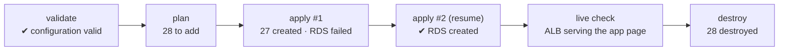
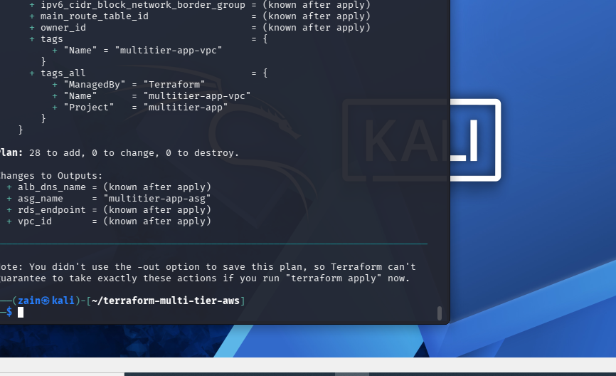
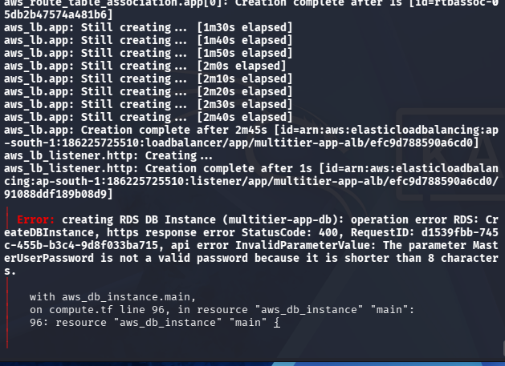
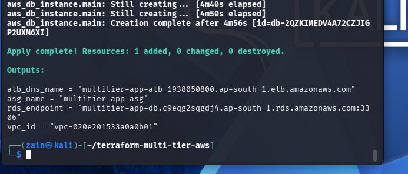
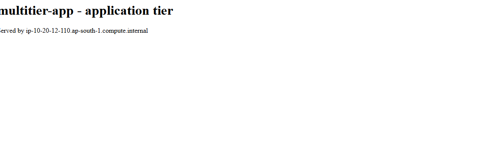
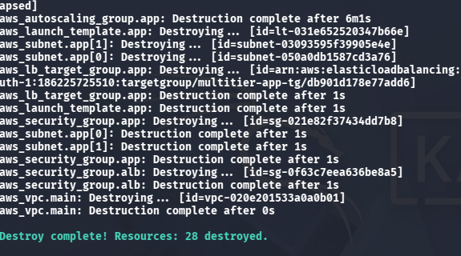
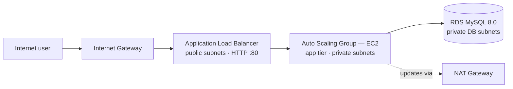

# Multi-Tier AWS Infrastructure with Terraform

> Infrastructure as Code for a classic **three-tier architecture** on AWS — a public load-balancer tier, a private application tier with Auto Scaling, and a private database tier, all inside one VPC spanning two Availability Zones.


-FF9900?logo=amazonaws&logoColor=white)


| At a glance | |
|---|---|
| **Architecture** | 3-tier: ALB → Auto Scaling Group (EC2) → RDS MySQL |
| **Network** | VPC 10.20.0.0/16 · 6 subnets (2 per tier) · 2 Availability Zones · 1 NAT Gateway |
| **Resources** | 28, all declared in code |
| **Security** | Chained security groups — every tier accepts traffic only from the tier in front of it |
| **Lifecycle proof** | Planned, applied, verified live, and destroyed on **6 November 2026** (see *Verified run*) |

---

## Verified run — 6 November 2026

This configuration was not just written — it was **run end-to-end on a real AWS account**. The first apply hit a genuine failure; it was diagnosed, fixed, and resumed. All times and outputs below are from the actual run.

**The run, as a horizontal pipeline:**



| Step | Result |
|---|---|
| `terraform validate` | ✅ Success — configuration is valid |
| `terraform plan` | ✅ **28 to add, 0 to change, 0 to destroy** |
| `terraform apply` (first run) | ⚠️ 27 resources created (VPC, subnets, NAT, ALB, listener, ASG), then RDS failed: *"The parameter MasterUserPassword is not a valid password because it is shorter than 8 characters"* |
| `terraform apply` (resume, valid password) | ✅ **Apply complete** — RDS created (4m56s); only the 1 remaining resource was added |
| Live verification | ✅ ALB served the application page from an app-tier instance (`Served by ip-10-20-12-110.ap-south-1.compute.internal`) |
| `terraform destroy` | ✅ **28 destroyed** — same session, to stop further charges |

**1. The plan — 28 resources, nothing to destroy:**



**2. The real failure — RDS rejected a too-short master password (the other 27 resources were already created):**



**3. Apply complete — outputs, including the RDS endpoint and VPC ID:**



**4. Live verification — the application tier answering through the load balancer:**



**5. Destroy complete — all 28 resources removed in the same session (note the VPC ID matches the one created in step 3):**



---

## Architecture

**Horizontal view — how a request travels through the system:**



**Tree view — the same system, laid out by tier:**

```
                        Internet
                           |
                    [ Internet Gateway ]
                           |
        ┌──────────────────┴──────────────────┐
        |              VPC 10.20.0.0/16        |
        |                                      |
        |  Public subnets (one per AZ)         |
        |    └─ Application Load Balancer      |
        |             |  (SG: HTTP from 0.0.0.0/0)
        |  Private app subnets (one per AZ)    |
        |    └─ Auto Scaling Group (EC2)       |
        |       min 2 · desired 2 · max 4      |
        |             |  (SG: HTTP only from ALB)
        |  Private DB subnets (one per AZ)     |
        |    └─ RDS MySQL 8.0                  |
        |       (SG: MySQL only from app tier) |
        └──────────────────────────────────────┘
        Private subnets reach the internet for updates via one NAT Gateway.
```

**Design rules that matter:**

- **Nothing in the private tiers is reachable from the internet.** The app servers and the database have no public IPs; traffic arrives only through the load balancer.
- **Security groups are chained** — each tier accepts traffic only from the tier in front of it (ALB → app → DB), never from a CIDR range.
- **Two Availability Zones** for subnets, the ASG, and the DB subnet group, so the design survives an AZ outage.
- **One NAT Gateway** instead of one per AZ — a deliberate practice-environment cost saving (production would use one per AZ, noted in the code).

## Files

| File | Contents |
|---|---|
| `providers.tf` | Terraform + AWS provider requirements, region, default tags |
| `variables.tf` | Region, project name, VPC CIDR, instance type, DB credentials (password is `sensitive`, no default) |
| `vpc.tf` | VPC, 6 subnets (2 per tier), Internet Gateway, NAT Gateway, route tables |
| `security.tf` | The three chained security groups (ALB / app / DB) |
| `compute.tf` | ALB + target group + listener, launch template, Auto Scaling Group, RDS MySQL |
| `outputs.tf` | VPC ID, ALB DNS name, RDS endpoint, ASG name |
| `terraform.tfvars.example` | Example variable values — copy to `terraform.tfvars` and fill in your own |
| `docs/` | Screenshots from the verified run (plan, failure, apply, live check, destroy) |

## Usage

```bash
# 1. Configure AWS credentials first (aws configure) with an IAM user.

# 2. Prepare variables
cp terraform.tfvars.example terraform.tfvars   # then edit, set a strong db_password

# 3. Initialise (downloads the AWS provider)
terraform init

# 4. Check the code
terraform validate
terraform fmt -check

# 5. Review exactly what would be created — creates nothing
terraform plan

# 6. Create (billable — see cost notes) / clean up everything afterwards
terraform apply
terraform destroy
```

Real `terraform.tfvars` and state files are git-ignored and must never be committed.

## Cost notes

`terraform apply` creates resources that cost money while they exist — mainly the **NAT Gateway**, the **Application Load Balancer**, the **RDS instance**, and the **EC2 instances**. Review `terraform plan` carefully before applying, and run `terraform destroy` as soon as practice is finished — exactly what was done in the verified run above.

## Skills demonstrated

Terraform (providers, variables, locals, count, data sources, outputs, sensitive values) · the complete infrastructure lifecycle — plan, apply, live verification, destroy · AWS VPC design (subnets, route tables, IGW, NAT) · load balancing and Auto Scaling · RDS · security-group design · troubleshooting a failed apply and resuming it · cost-aware infrastructure decisions

---

## Author

**Zain Ul Abdin** — Founder, **Zain Tech Automation Solutions** · Karachi, Pakistan
GitHub: [@zain-ul-abadeen-1213](https://github.com/zain-ul-abadeen-1213)
